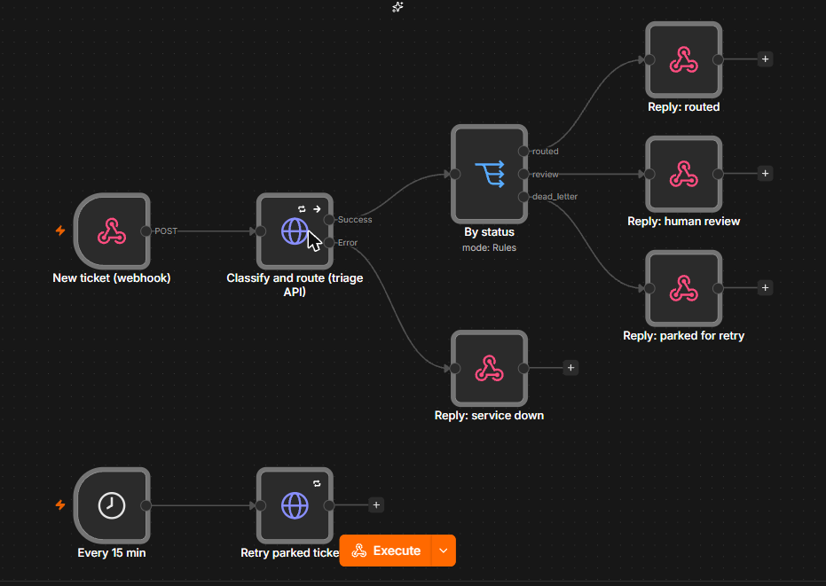

# ticket-triage-automation

Customer-service automation for an online furniture shop: an **n8n** workflow receives a ticket
by webhook, a small **Python/FastAPI** service masks personal data, asks a **local LLM** for a
structured label (category, urgency, language), routes the ticket to a team with an SLA and
answers n8n; uncertain tickets go to a human review queue, and tickets that hit a model outage
are parked and retried on a schedule - nothing is lost. Time saved is measured, not claimed.

```
customer form / mailbox
        |  POST /webhook/ticket
        v
  n8n: Webhook --> HTTP Request (3 tries, 2 s apart) --> Switch on status
                         | error branch                  |-- routed      -> 200 "Routed to claims (SLA 4 h)"
                         v                               |-- review      -> 202 "Queued for a human"
                  503 "service down"                     '-- dead_letter -> 202 "Will be retried"
  n8n: every 15 min --> POST /dead-letters/retry

  triage API (FastAPI, X-Webhook-Token)
    mask e-mail / phone / IBAN  ->  LLM JSON label (Ollama, structured output)
    -> validate (allowed values, 0-1 confidence) -> 1 retry -> else human review
    -> confidence < 0.7 -> human review
    -> route: category -> team, urgency -> SLA (4 / 24 / 72 h)
    -> SQLite (masked text only), idempotent on ticket_id, metrics
```



*The workflow imported into n8n (cloud editor); the JSON export is `n8n/ticket-triage.workflow.json`.*

## Results

`scripts/evaluate.py` with `qwen2.5:7b-instruct` (local, Ollama) on the 96 labelled synthetic
tickets (`eval/qwen2.5_7b-instruct.md`, per-ticket log in `eval/runs/`):

| metric | value |
|---|---|
| category accuracy | 85.4% |
| **correct team** (what routing actually needs) | **94.8%** |
| urgency accuracy | 83.3% |
| language (PL / EN) | 100% |
| median time per ticket | 5.3 s (laptop GPU) |
| personal data items masked before the model | 33 / 33 planted |

Most frequent confusions: `other -> product_question` (6), `payment_invoice -> return_refund`
(3), `other -> order_change` (3). Most of them stay within the same team, which is why team
accuracy is 9 points higher than category accuracy.

**The honest finding: the model's self-reported confidence is useless for routing.** It never
reported less than 0.7, so the human-review branch was never triggered, although 14.6% of
categories were wrong. A confidence threshold on an LLM's own number is not a safety net.
Next step: route to review on a measurable signal instead - disagreement between two
prompts/models, or token log-probabilities - and calibrate the threshold on labelled data.

At an assumed 3 minutes of manual triage per ticket, 1,000 tickets a month would save about
50 hours; with ~5% of tickets routed to the wrong team that needs re-routing, the realistic
figure is lower, and the assumption should be replaced by a measured baseline.

## What it shows (mapped to the job ad)

| requirement | where |
|---|---|
| automations with n8n, APIs, webhooks | `n8n/ticket-triage.workflow.json`, `src/triage/api.py` |
| error handling, reliability | HTTP retries + error branch in n8n; JSON validation and retry; dead-letter queue with scheduled retry; idempotent `ticket_id` |
| AI / LLM capabilities | `src/triage/classify.py`: structured output, validation, confidence threshold, human-in-the-loop |
| security and data protection | personal data masked **before** the LLM, logs and the database (`src/triage/privacy.py`); shared-secret header; secret only from the environment |
| measuring results, time saved | `GET /metrics` (automation rate, minutes saved), `scripts/evaluate.py` on a labelled set |

## Run it

```bash
python -m venv venv && venv/Scripts/pip install -e ".[dev]"
pytest                                            # unit + API + workflow checks
ollama pull qwen2.5:7b-instruct
set TRIAGE_TOKEN=some-long-random-secret
venv/Scripts/uvicorn triage.api:app --port 8000   # the triage service

# n8n (Node 20/22): import and start, with the same secret in its environment
set TRIAGE_TOKEN=some-long-random-secret
npx n8n import:workflow --input=n8n/ticket-triage.workflow.json
npx n8n start                                     # activate the workflow in the editor

curl -X POST http://localhost:5678/webhook/ticket -H "Content-Type: application/json" ^
     -d "{\"ticket_id\":\"T-1\",\"text\":\"Order TY-1234567 arrived broken\"}"

python scripts/make_dataset.py && python scripts/evaluate.py   # labelled evaluation
```

## Data

`data/tickets_labelled.jsonl` is **synthetic**: 96 tickets (8 categories x 12, half Polish, half
English) generated from templates by `scripts/make_dataset.py`, with fake e-mails, phones and
IBANs planted to test the masking. Synthetic data keeps real customers out of a public repo,
but templates are easier than real mail - treat the accuracy as an upper bound and re-measure
on a real sample before rollout.

## Limitations

- The manual-triage time (3 min per ticket) is an assumption to replace with a measured value.
- One model (`qwen2.5:7b-instruct`) on a 6 GB laptop GPU; a larger model would likely do better
  on urgency, which is the most subjective field.

## PL - w skrócie

Automatyzacja obsługi zgłoszeń klientów sklepu meblowego: przepływ n8n (webhook, ponowienia,
gałąź błędu, kolejka ponowień co 15 min) + serwis FastAPI, który maskuje dane osobowe przed
wysłaniem do lokalnego LLM, klasyfikuje zgłoszenie (kategoria, pilność, język), kieruje je do
zespołu z SLA, niepewne przypadki oddaje człowiekowi i mierzy zaoszczędzony czas. Dane
syntetyczne (PL/EN), 31 testów.

## License

MIT
